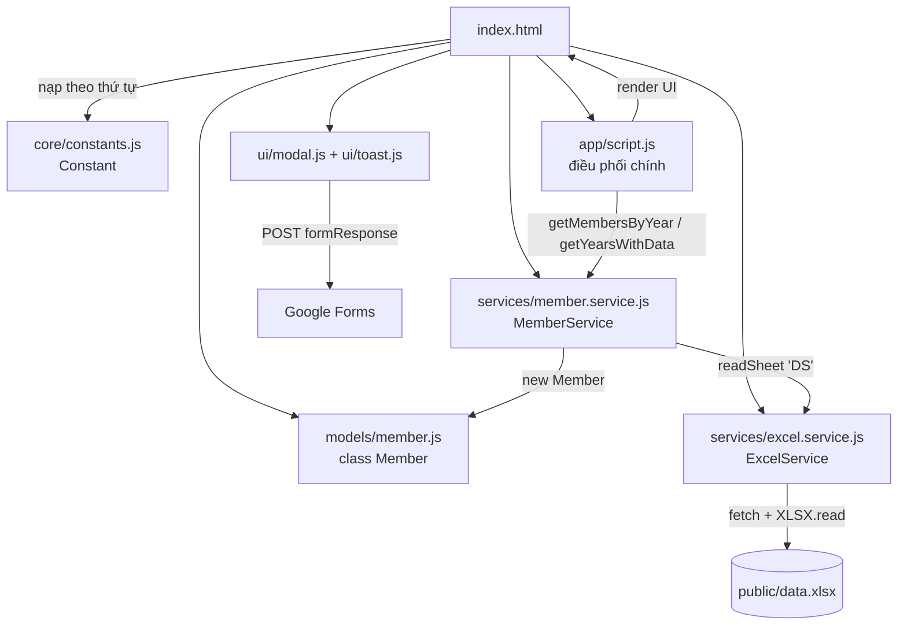

# 📋 Tài Liệu Phân Tích Dự Án — Học Chúng Chánh Tâm

> **Phân tích ngày:** 2026-11-12 · **Nhánh:** `dev` · **Commit:** `c7d78bc`
> **Repo:** `bantruyenthongchanhtam/hoc-chung-chanh-tam` · **Triển khai:** GitHub Pages

---

## 1. Tổng Quan Dự Án

**Học Chúng Chánh Tâm** là website danh bạ thành viên của lớp học Học Chúng Chánh Tâm thuộc **Tự viện Phước Duyên, TP. Huế** — một dự án của Ban Truyền Thông Chánh Tâm.

| Hạng mục | Chi tiết |
|---|---|
| **Mục đích** | Hiển thị danh sách thành viên theo năm kết nạp, tìm kiếm, lọc nhóm, gửi tâm sự |
| **Loại ứng dụng** | Static website (không backend, không build step) |
| **Nguồn dữ liệu** | File Excel `public/data.xlsx` — cập nhật thành viên chỉ cần sửa file Excel, không cần đổi code |
| **Triển khai** | GitHub Pages — `https://bantruyenthongchanhtam.github.io/hoc-chung-chanh-tam/` |
| **Ngôn ngữ** | Tiếng Việt (song ngữ trong comment code: Việt / Anh) |
| **Quy mô** | ~2.000 dòng code (JS ~1.460 dòng, CSS 556 dòng) + 409 bản ghi thành viên |

**Triết lý thiết kế:** tối giản số request HTTP, không framework, toàn bộ nghiệp vụ chạy trên trình duyệt.

---

## 2. Công Nghệ Sử Dụng

| Công nghệ | Vai trò | Nguồn |
|---|---|---|
| **Vanilla JavaScript** (ES6+) | Toàn bộ logic, module pattern IIFE | Không phụ thuộc |
| **Tailwind CSS** (CDN) | Utility-first CSS cho layout | `cdn.tailwindcss.com` |
| **SheetJS (xlsx.full.min.js)** | Đọc & parse file Excel phía client | Local `assets/libs/` |
| **Lucide Icons** | Bộ icon SVG | Local `assets/libs/` |
| **Google Fonts** | Quicksand (body), Noto Serif Vietnamese (tiêu đề) | CDN |
| **Google Forms** | Nhận nội dung "Góc Tâm Sự" (không cần backend) | Tích hợp qua hidden iframe |
| **CSS thuần** | Component riêng: card, toast, modal, animation | `assets/styles/style.css` |

> ⚠️ Không có `package.json`, không có build/bundler — tất cả file JS được nạp trực tiếp qua thẻ `<script>` theo thứ tự phụ thuộc.

---

## 3. Cấu Trúc Thư Mục

```
hoc-chung-chanh-tam/
├── index.html                 # Entry point — layout, SEO meta, nạp script
├── README.md                  # Tài liệu mô tả dự án
│
├── src/                       # Mã nguồn ứng dụng (8 file JS)
│   ├── core/constants.js      #   Cấu hình tập trung (81 dòng)
│   ├── models/member.js       #   Model Member + normalize ảnh (51 dòng)
│   ├── services/
│   │   ├── excel.service.js   #   Tải & cache Excel, TTL 5 phút (125 dòng)
│   │   └── member.service.js  #   Nghiệp vụ dữ liệu thành viên (185 dòng)
│   ├── ui/
│   │   ├── modal.js           #   Modal "Góc Tâm Sự" → Google Forms (197 dòng)
│   │   └── toast.js           #   Hệ thống thông báo 4 loại (128 dòng)
│   └── app/script.js          #   Ứng dụng chính (828 dòng)
│
├── assets/
│   ├── styles/style.css       # Biến CSS + component + animation (556 dòng)
│   ├── libs/                  # lucide.min.js, xlsx.full.min.js (local)
│   ├── images/                # logo, favicon, thumbnail, avatar mặc định
│   └── audio/background_music.mp3
│
├── public/
│   ├── data.xlsx              # DỮ LIỆU CHÍNH — 2 sheet: DS + SORT_ORDER
│   └── member-images/         # Ảnh thành viên theo năm (2011→2026, NO)
│
├── config/                    # (trống — dành cho tương lai)
├── docs/                      # Tài liệu (file phân tích này)
└── .vscode/settings.json
```

---

## 4. Kiến Trúc & Luồng Dữ Liệu

### 4.1. Sơ đồ kiến trúc



### 4.2. Luồng khởi động (`window.onload` trong `script.js:196`)

1. `DOM_CACHE.init()` — cache các phần tử DOM thường dùng
2. `wrapWithLoader()` — hiển thị loader toàn cục (chờ 400ms cho animation)
3. `MemberService.getYearsWithData()` → tải Excel → parse sheet `DS` → sinh danh sách năm động
4. `renderYearTabs()` + `updateDisplay()` — render tab năm và lưới thành viên
5. Khởi tạo: hiệu ứng hoa sen (`initLotusEffect`), trình phát nhạc (`initMusic`), sự kiện (`initEvents`), icon Lucide, Toast

### 4.3. Luồng tìm kiếm / lọc / sắp xếp

```
Input người dùng (search/group/sort/limit/year)
  → debounce 300ms (riêng search)
  → memoCache.clear()
  → updateDisplay()
      → MemberService.getMembersByYear(year)   [cache toàn bộ thành viên]
      → applyFilters(members)                   [memo theo key searchQuery|groupFilter]
      → applySort(members)                      [memo theo sortType + inputRef]
      → phân trang (slice) → renderMemberCard() [innerHTML template]
```

---

## 5. Phân Tích Chi Tiết Từng Module

### 5.1. `src/core/constants.js` — Cấu hình tập trung

Module IIFE trả về object **đóng băng** (`Object.freeze`), chứa mọi "magic number":

| Nhóm | Giá trị chính |
|---|---|
| `CONFIG.DATABASE` | `DATA_EXCEL_URL: "./public/data.xlsx"`, `SHEET_NAME: "DS"`, `CACHE_TIME_MS: 5 phút` |
| `CONFIG.GOOGLE_FORM` | `FORM_ID`, `ENTRY_ID: entry.1611862614` |
| `MEMBER.FIELDS` | Ánh xạ cột Excel 0–9: ID, FULL_NAME, NICK_NAME, NAME, POSITION, GROUP, YEAR, NOTE, IMAGE, SORT_ORDER |
| `MEMBER.ROW_MIN_LENGTH` | `10` (số cột tối thiểu để hàng hợp lệ) |
| `TAB_LIMITS` | Mobile: 3 tab năm / Desktop: 5 tab năm |
| `FORM_LIMITS` | Tin nhắn 1–500 ký tự |
| Khác | `ITEMS_PER_PAGE: 8`, `DEFAULT_AVATAR`, `MEMBER_IMAGE_PATH`, `ALL: "Tất cả"`, `UNKNOWN_YEAR: "Không rõ"` |

> 📌 `MEMBER.START_YEAR: 2008` đang **không được dùng** ở bất kỳ đâu — cấu hình thừa sau khi đổi sang phát hiện năm động (commit `0ca23ef "change logic year"`).

### 5.2. `src/models/member.js` — Model thành viên

- Lớp `Member` với **10 thuộc tính**: `id, fullName, name, nickName, position, group, year, note, img, sortOrder`
- `Member.normalizeImagePath()` (static) — xử lý linh hoạt cột ảnh trong Excel:
  - Trích URL từ chuỗi HTML `href="..."` hoặc Markdown ``
  - URL tuyệt đối (`http(s)://`) hoặc bắt đầu `./` → dùng nguyên trạng
  - Còn lại → tự nối tiền tố `./public/member-images/` (có strip tiền tố thừa)
  - Rỗng → trả về đường dẫn thư mục ảnh (UI sẽ thay bằng avatar mặc định)

### 5.3. `src/services/excel.service.js` — Tải & cache Excel

| Hàm | Chức năng |
|---|---|
| `loadWorkbook()` (private) | `fetch` file Excel (cache HTTP có điều kiện) → `XLSX.read(arrayBuffer)` → cache workbook trong bộ nhớ **TTL 5 phút**; lỗi thì toast + throw |
| `readSheet(name)` | Đọc sheet → `sheet_to_json(header: 1)` → bỏ hàng tiêu đề; mọi lỗi trả `[]` an toàn |
| `clearCache()` | Xóa cache thủ công |

Xử lý lỗi khá kỹ: kiểm tra HTTP status, file rỗng, parse error, workbook thiếu SheetNames, sheet không tồn tại.

### 5.4. `src/services/member.service.js` — Nghiệp vụ thành viên

- `loadAllMembers()`: đọc sheet `DS` → lọc hàng hợp lệ (`≥10 cột`, có ít nhất 1 ô khác rỗng) → map sang `Member` → **sort theo `sortOrder`** → cache **vô thời hạn** (không TTL, chỉ hết khi reload trang)
- `loadYear(year)`: lọc từ cache — `year === "Tất cả"` trả tất cả; `"Không rõ"` trả thành viên có năm không phải số; còn lại so khớp chuỗi
- `getAllYears()`: sinh tab năm động — `["Tất cả", 2026, 2025, … 2008, "Không rõ"?]` (giảm dần, "Không rõ" chỉ xuất hiện nếu có dữ liệu)
- `getYearsWithData()`: alias tương thích ngược, fallback `["Tất cả"]` khi lỗi

### 5.5. `src/ui/modal.js` — Góc Tâm Sự (Google Forms)

- Mở/đóng modal (class `active`, khóa scroll body, auto-focus textarea sau 100ms, đóng bằng phím `Escape`)
- `validateMessage()`: trim, kiểm tra độ dài 1–500 ký tự
- Cơ chế gửi **không cần backend**: tạo `<form>` ẩn → POST tới `docs.google.com/forms/d/e/{FORM_ID}/formResponse` với `target=hidden_iframe` → chờ 600ms → dọn dẹp → toast thành công
- Expose `openModal()` / `closeModal()` toàn cục cho `onclick` trong HTML

> ⚠️ **Hạn chế:** `form.submit()` qua iframe không có callback — không thể biết gửi thật sự thành công hay thất bại; hiện luôn báo thành công sau 600ms.

### 5.6. `src/ui/toast.js` — Thông báo

- 4 loại: `success / error / warning / info` (icon + màu riêng)
- Xây DOM bằng `createElement` + `textContent` (**an toàn XSS**)
- Thanh tiến trình đếm ngược, tự ẩn sau 4s, nút đóng thủ công, animation trượt, dọn timer khi unload

### 5.7. `src/app/script.js` — Ứng dụng chính (828 dòng)

Khối lượng lớn nhất, gồm 9 nhóm chức năng:

| Nhóm | Điểm nổi bật |
|---|---|
| **State + DOM_CACHE** | 8 biến trạng thái toàn cục; cache 17 phần tử DOM thay vì query lặp lại |
| **debounce + memoCache** | Search debounce 300ms; memo kết quả filter (key `query\|group`) và sort (key `sortType` + so tham chiếu mảng — O(1) thay vì JSON.stringify O(n)) |
| **Tìm kiếm không dấu** | Bảng map 67 ký tự có dấu → không dấu dựng sẵn 1 lần + regex dựng sẵn; `exactMatch` so khớp chuỗi con sau khi bỏ dấu + lowercase — gõ "nguyen tung" vẫn ra "Nguyễn Tùng" |
| **Tab năm** | Phát hiện năm động từ dữ liệu; phân trang tab (3 mobile / 5 desktop) với nút prev/next tự disable |
| **Lọc nhóm** | Tách nhóm phức (`"A, B, C"` → 3 option); cache danh sách nhóm theo năm; tự reset nếu nhóm đã chọn không còn tồn tại |
| **Sắp xếp** | `localeCompare(…, 'vi', {sensitivity: 'base'})` — đúng chuẩn tiếng Việt cho A-Z / Z-A |
| **Phân trang** | Tối đa 3 số trang + dấu `...`, nút `<` `>`, text "Hiển thị X–Y trên tổng số Z", cuộn mượt về lưới |
| **Music player** | Play/pause, volume slider 0–100%, tự ẩn panel âm lượng sau 2s, đổi icon + tooltip theo trạng thái |
| **Hiệu ứng hoa sen** | Particle SVG rơi ngẫu nhiên (vị trí, kích thước 20–40px, thời lượng 8–13s), sinh mỗi 1.5s, tự dọn sau 10s |

Render card dùng template string + `innerHTML`: ảnh `loading="lazy"` + skeleton + `onerror` fallback về avatar mặc định, highlight từ khóa tìm kiếm bằng `<mark>`.

### 5.8. `assets/styles/style.css` — Giao diện

- **Design token đầy đủ** qua CSS variables: màu (theme cam `#ea580c`), bóng đổ, z-index 6 tầng, thời lượng animation, border-radius
- Component: profile card (hover nổi lên 8px), tab active, tag nhóm (gradient cam), pagination, modal, toast 4 màu + progress bar, volume control, scrollbar tùy chỉnh
- Animation: fade-in, spin loader, shimmer skeleton, blob trang trí nền, hoa sen rơi
- Responsive: điều chỉnh riêng cho mobile ở cuối file

### 5.9. `index.html` — Entry point

- **SEO đầy đủ**: title, description, canonical, Open Graph (1200×630), Twitter Card, `og:locale vi_VN`
- Layout: header → tab năm → search/filter/sort/page-size → lưới thành viên responsive (1→4 cột) → phân trang → footer (logo, địa chỉ, Facebook/YouTube, nút tâm sự) → loader toàn cục → modal → music player
- Nạp script đúng thứ tự phụ thuộc: `constants → member → excel → member.service → modal → toast → script`

---

## 6. Phân Tích Dữ Liệu (`public/data.xlsx`)

### 6.1. Sheet `DS` — dữ liệu chính (app chỉ đọc sheet này)

986 hàng (985 hàng dữ liệu + 1 header), trong đó **409 hàng có dữ liệu** — schema 10 cột:

| # | Cột | Kiểu | Ví dụ |
|---|---|---|---|
| 0 | `id` | số | `1` |
| 1 | `full_name` | text có dấu | `Lý Thanh Tùng` |
| 2 | `nick_name` | text, có thể rỗng | `Tbh` |
| 3 | `name` | tên gọi ngắn | `Tùng` |
| 4 | `position` | chức vụ | `Lớp trưởng`, `Trưởng ban truyền thông` |
| 5 | `group` | nhóm, **phân tách bằng dấu phẩy** | `Chánh Tâm Nhỏ, Hít Thở Mỉm Cười, Tâm An` |
| 6 | `year` | năm kết nạp | `2017` |
| 7 | `note` | ghi chú, **có thể chứa HTML** | `<a href="…">🎨🌧️🎧</a>` |
| 8 | `img` | đường dẫn ảnh tương đối | `2017/LY_THANH_TUNG.webp` |
| 9 | `sort_order` | độ ưu tiên hiển thị 0–10 | `2` |

### 6.2. Thống kê thành viên theo năm (409 người)

| Năm | SL | Năm | SL | Năm | SL |
|---|---|---|---|---|---|
| 2008 | 7 | 2017 | 9 | 2022 | 27 |
| 2011 | 5 | 2018 | 6 | 2023 | 49 |
| 2012 | 4 | 2019 | 7 | **2024** | **90** |
| 2013 | 2 | 2020 | 12 | 2025 | 13 |
| 2014 | 1 | 2021 | 9 | **2026** | **98** |
| 2015 | 2 | — | — | Không rõ | 67 |
| 2016 | 1 | — | — | **Tổng** | **409** |

- Không có dữ liệu năm **2009, 2010** → tab năm không hiển thị (đúng theo logic phát hiện động)
- 67 người chưa có năm hợp lệ → gom vào tab **"Không rõ"** (thư mục ảnh tương ứng: `member-images/NO/`)
- Đỉnh kết nạp: 2024 (90) và 2026 (98) — dữ liệu 2026 đang được bổ sung

**Nhóm xuất hiện:** Chánh Tâm Nhỏ, Hít Thở Mỉm Cười, Tâm An, Thích Yêu Thương, Nắng Yêu Thương, Tương Sinh, Bô lão, Chưa có nhóm.
**Vị trí tiêu biểu:** Lớp trưởng, Trưởng ban (hậu cần / hoạt náo / tài chính / trang trí / truyền thông / văn nghệ-thỉnh sư), Ban chấp hành (kèm nhiệm kỳ), Ban cố vấn.

### 6.3. Sheet `SORT_ORDER` — bảng tham chiếu (app KHÔNG đọc)

| sort_order | Vai trò |
|---|---|
| 0 | Ôn |
| 1 | Quý Thầy |
| 2 | Lớp trưởng |
| 3 | Trưởng ban |
| 4 | Ban chấp hành |
| 5 | Ban cố vấn thường trực |
| 6 | Thành viên thường trực |
| 7 | Ban cố vấn không thường trực |
| 8 | Quý dì |
| 9 | Thành viên không thường trực |
| 10 | Thành viên không rõ |

→ Sheet này là tài liệu chuẩn cho người nhập liệu; code chỉ dùng giá trị số để sort.

### 6.4. Ảnh thành viên

- Tổ chức: `public/member-images/{năm}/{HO_TEN.webp}` — năm 2011→2026 + `NO`
- Định dạng WebP; fallback avatar mặc định `assets/images/avatars/user.webp` qua `onerror`
- Chấp nhận cả URL ngoài (HTML/Markdown) nhờ `normalizeImagePath()`

### 6.5. Tên trùng lặp theo năm kết nạp (kiểm tra ngày 2026-11-12)

So sánh trên **409 bản ghi** với chuẩn hóa bỏ dấu + lowercase + gộp khoảng trắng:

**a) Trùng tên đầy đủ TRONG CÙNG 1 năm — chỉ 1 nhóm:**

| Năm | Tên | Số lần | id | Chức vụ | Nhóm |
|---|---|---|---|---|---|
| 2026 | Hoàng Thị Ngọc Thi | ×2 | 324, 343 | Thành viên mới | Chưa có nhóm / Tương Sinh |

→ ⚠️ **Cần xác minh**: khác nhóm nên có thể là 2 người trùng tên thật; nếu là nhập trùng thì cần xóa 1 bản ghi.

**b) Trùng tên GIỮA CÁC NĂM KHÁC NHAU — 6 nhóm (nhiều khả năng là 2 người khác nhau):**

| Tên | Năm | id | Ghi chú |
|---|---|---|---|
| Lê Thị Ngọc | 2021, 2022 | 84, 85 | Nghi vấn: nhập 2 năm liền — kiểm tra |
| Trần Thị Anh Thư | 2025, 2026 | 97, 98 | Kiểm tra thêm |
| Nguyễn Thị Thanh Phương | 2018, 2023 | 105, 215 | Chức vụ khác (BCH / thành viên) |
| Huỳnh Thị Kim Anh | 2008, 2024 | 116, 136 | Khác xa nhau về năm |
| Hồ Thị Thanh Hiền | 2022, 2024 | 163, 164 | Kiểm tra thêm |
| Lê Thị Băng Nhi | 2024, Không rõ | 209, 386 | ⚠️ Nghi vấn cao nhất: bản ghi "Không rõ" có thể trùng người, thiếu năm |

**c) Trùng tên gọi (cột `name`) trong 1 năm — chỉ ở năm 2026:** `Su` ×3, `Nhím` ×2, `Ken` ×2, `Bi` ×2 — không ảnh hưởng giao diện vì card hiển thị theo `full_name`.

**Kết luận:** dữ liệu khá sạch (chỉ 1 trùng thật trong cùng năm). Việc cần làm: xác minh nhóm (a) và 2 nghi vấn nổi bật ở (b) — id 209/386 và 84/85.

---

## 7. Tính Năng Chính (Góc Nhìn Người Dùng)

1. 🗂️ Duyệt thành viên theo năm kết nạp (tab động, tự ẩn năm không có dữ liệu)
2. 🔍 Tìm kiếm tiếng Việt **không cần gõ dấu**, highlight từ khóa, có nút xóa
3. 👥 Lọc theo nhóm (tách nhóm phức), sắp xếp A-Z / Z-A theo locale Việt
4. 📄 Phân trang 8/20/100/200 mỗi trang
5. 💬 "Góc Tâm Sự" — gửi tin nhắn ẩn danh về Google Form của Ban Truyền Thông
6. 🎵 Nhạc nền có điều khiển âm lượng, tự ẩn
7. 🪷 Hiệu ứng hoa sen rơi, blob nền, skeleton loading ảnh
8. 📱 Responsive mobile-first; SEO/OG cho chia sẻ mạng xã hội

---

## 8. Hiệu Năng & Bảo Mật

### Hiệu năng
- ✅ Cache 3 tầng: HTTP có điều kiện → workbook (TTL 5') → danh sách Member (phiên làm việc)
- ✅ Debounce search, memoize filter/sort, DOM cache, DocumentFragment, ảnh lazy + WebP + kích thước khai báo sẵn (tránh layout shift)
- ✅ Icon + thư viện xlsx chạy local, đã minify

### Bảo mật
- ✅ Toast xây DOM an toàn (textContent) — chống XSS
- ✅ Không lưu dữ liệu nhạy cảm; Google Forms là điểm nhận duy nhất
- ⚠️ Xem mục 9.2 — `renderMemberCard` dùng `innerHTML` với dữ liệu Excel

---

## 9. Đánh Giá & Nhận Xét

### 9.1. Điểm mạnh

1. **Kiến trúc rõ ràng** cho dự án không build-tool: tách layer core/models/services/ui/app, module IIFE đóng băng, comment song ngữ nhất quán
2. **CMS "0 đồng"**: cập nhật thành viên chỉ bằng file Excel — phù hợp người vận hành không biết code
3. **Xử lý tiếng Việt tử tế**: bỏ dấu tìm kiếm, sort locale `vi`, font tiếng Việt riêng
4. **Hiệu năng được chăm chút**: cache nhiều tầng, debounce, memoize, lazy image, skeleton
5. **Xử lý lỗi phòng thủ**: mọi lớp service đều có try/catch + fallback + toast thân thiện

### 9.2. Vấn đề phát hiện (theo mức độ)

| # | Mức | Vấn đề | Vị trí |
|---|---|---|---|
| 1 | TB | **XSS tiềm ẩn**: `renderMemberCard()` nối `fullName/position/group/note/img` thẳng vào `innerHTML` mà không escape; `highlightText` chỉ escape *từ khóa*, không escape *nội dung*. README ghi "dùng DOM methods" nhưng chỉ Toast làm được. Dữ liệu hiện do Ban DST kiểm soát nên rủi ro thấp, nhưng nếu nhiều người cùng sửa Excel thì nên escape | `script.js:742-771` |
| 2 | TB | **Modal báo thành công "mù"**: submit qua hidden iframe + `setTimeout(600ms)` — không xác nhận được Google Forms đã nhận; lỗi mạng vẫn hiện "Gửi tin nhắn thành công!" | `modal.js:129-140` |
| 3 | Nhẹ | **Thẻ đóng trùng lặp** `</body></html>` xuất hiện 2 lần cuối file | `index.html:282-284` |
| 4 | Nhẹ | **README lỗi thời so với code**: ghi `ROW_MIN_LENGTH: 8` (thực tế 10), model 8 thuộc tính (thực tế 10 — thiếu `nickName`, `year`), nhắc tới `bundle.js` không tồn tại (index.html nạp 7 file JS riêng), ví dụ ảnh `2008/01.jpg` (thực tế `2017/TEN.webp`) | `README.md` |
| 5 | Nhẹ | **Cấu hình chết**: `START_YEAR: 2008` không còn được tham chiếu sau khi đổi sang năm động | `constants.js:44` |
| 6 | Nhẹ | **Cache không nhất quán**: workbook TTL 5 phút nhưng `membersCache` không TTL — trong cùng phiên, cập nhật Excel sẽ không bao giờ hiện ra dù cache Excel hết hạn | `member.service.js:66` |
| 7 | Gợi ý | **Tailwind CDN cho production**: chính Tailwind khuyến cáo không dùng CDN ở production (chậm, không purge, cảnh báo console). Dự án tĩnh nên cân nhắc build CSS local hoặc giữ nguyên nếu chấp nhận đánh đổi | `index.html:259` |
| 8 | Gợi ý | JSDoc của `Member` bị dán nhầm dòng code vào giữa comment | `member.js:30` |
| 9 | Gợi ý | Lỗi copy-paste nhỏ: tạo biến `dot` rồi không dùng, vẫn gọi `createEllipsis()` | `script.js:613-618` |

### 9.3. Đề xuất cải tiến

1. **Escape HTML** trong `renderMemberCard` (giữ whitelist cho `<a>` trong `note` nếu cần giữ tính năng link)
2. Kiểm tra gửi form thành công thật (dùng `fetch` no-cors + `URLSearchParams`, hoặc giữ nguyên và ghi rõ hạn chế)
3. Dọn `START_YEAR`, sửa README theo code hiện tại, bỏ thẻ `</body>` thừa
4. Thêm TTL hoặc nút "Làm mới dữ liệu" cho `membersCache`
5. Tách `script.js` (828 dòng) thành controller + views nhỏ hơn nếu dự án tiếp tục lớn
6. Bổ sung kiểm tra tự động cho dữ liệu Excel (script nhỏ đối chiếu 409 bản ghi ↔ file ảnh tồn tại)

---

## 10. Hướng Dẫn Vận Hành

### Thêm thành viên mới
1. Mở `public/data.xlsx` → sheet `DS`, thêm 1 hàng đủ 10 cột (xem schema mục 6.1)
2. Đặt ảnh vào `public/member-images/{năm}/TEN_WEBP.webp`, nhập đường dẫn `"{năm}/{TEN_WEBP}.webp"`
3. `sort_order` tra bảng mục 6.3 (0=Ôn … 10=không rõ)
4. Commit & push → GitHub Pages tự cập nhật; người dùng đã mở trang cần reload (cache)

### Đổi cấu hình
Sửa `src/core/constants.js`: URL Excel, TTL cache, số item/trang, giới hạn tab, Google Form ID, giới hạn tin nhắn.

### Git flow hiện tại
- Nhánh `dev` để phát triển, PR vào `main` để triển khai
- Lịch sử commit chủ yếu là `add data` (cập nhật data.xlsx) — đúng bản chất "Excel-as-CMS"

---

*Tài liệu được tạo tự động bởi ZCode — tổng hợp từ việc đọc toàn bộ mã nguồn, phân tích file `data.xlsx` và lịch sử Git của dự án.*
